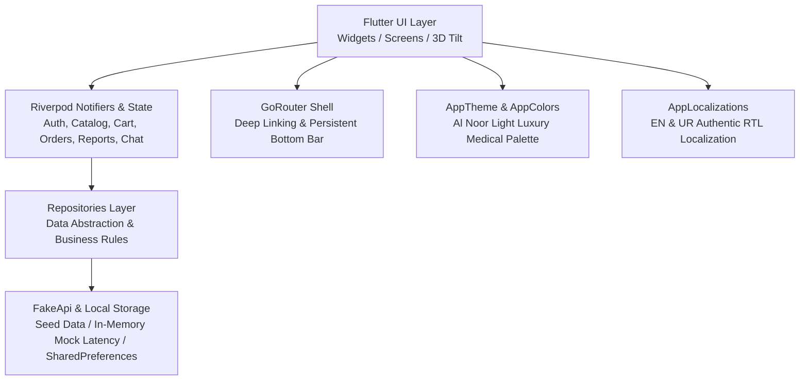

# Al Noor Diagnostic Centre - System Architecture

## 1. Overview
The **Al Noor Diagnostic Centre** mobile application is engineered following modern, production-grade Flutter best practices. It delivers a fast, responsive, bilingual (English & Urdu RTL) diagnostic and healthcare management experience tailored specifically for the Pakistani healthcare landscape (Lahore flagship campus, UAN `111 939 939`, PKR currency, and local payment methods).



---

## 2. Feature-First Directory Structure
The codebase follows a strict feature-first architecture (`lib/features/*` and `lib/core/*`), ensuring high modularity, high maintainability, and clean separation of concerns:

```
lib/
├── core/
│   ├── l10n/                 # Localization (AppLocalizations with authentic EN/UR dictionary)
│   ├── router/               # GoRouter configuration with StatefulShellRoute & deep links
│   ├── theme/                # Al Noor Light medical tokens, color system, typography
│   └── widgets/              # Reusable core design system widgets (3D card, buttons, inputs)
├── data/
│   ├── demo/                 # Seed data (120+ clinical tests, 4 users, branches, tips) & FakeApi
│   ├── models/               # Strongly-typed immutable data models
│   └── repositories/         # Riverpod providers & state notifiers for data operations
├── features/
│   ├── auth/                 # Login, OTP verification, PIN setup/unlock, Profile switcher
│   ├── booking/              # 7-step Home sampling booking, Radiology booking, Success flow
│   ├── catalog/              # Test catalog with search/filter, Packages & package detail
│   ├── chat/                 # Live support chat (8 agents), Al Noor AI Assistant orb
│   ├── doctors/              # Consultant directory, specialized clinical booking
│   ├── health/               # My Health metrics, 3D metallic Health Cards, Family profiles
│   ├── home/                 # Dynamic home feed, Offers, Branches directory, Notifications
│   ├── onboarding/           # Splash screen, Language selection (EN/UR), Onboarding carousel
│   ├── orders/               # Active & historical bookings, live sample tracker with ETA
│   ├── reports/              # Diagnostic documents, PDF viewer/share, biomarker trends
│   └── settings/             # User profile, privacy, security, language, theme controls
└── main.dart                 # Application entry point, ProviderScope initialization
```

---

## 3. State Management (Riverpod)
The application utilizes **Riverpod** (modern code-generation-free `Notifier` & `NotifierProvider` pattern):
- **Predictable State Mutations:** All state is immutable and mutated exclusively via dedicated notifiers.
- **Dependency Decoupling:** UI widgets access business logic via `ref.watch` or `ref.read` without tight coupling to underlying storage mechanisms.
- **Key Providers:**
  - `authProvider` (`AuthNotifier`): Manages active session, OTP state, authenticated user (`User`), and active family member switching.
  - `catalogProvider` (`CatalogNotifier`): Search queries, department filter chips, test details, and package catalogs.
  - `cartProvider` (`CartNotifier`): Cart state, patient assignment per test, coupon code validation (e.g. `ALNOOR10`, `HEALTH20`, `FREESAMPLE`), subtotal, discount, and home sampling charges.
  - `ordersProvider` (`OrdersNotifier`): Active sample collection tracking, sample collection timeline stages, historical orders, and cancellation flows.
  - `reportsProvider` (`ReportsNotifier`): Patient diagnostic reports, biomarker extraction, normal range comparison, and longitudinal trend graphs.
  - `chatProvider` (`ChatNotifier`): Live chat messages with assigned support agents, automated replies, and typing state.
  - `themeModeProvider` / `localeProvider`: Global dynamic UI customization with instant rebuilds.

---

## 4. Navigation & Deep Linking (GoRouter)
The routing system is powered by **GoRouter** with deep linking and persistent navigation:
- **Stateful Shell Route:** The bottom navigation bar (`Home`, `Reports`, `Doctors`, `Health`, `More`) remains persistent across tab transitions without rebuilding child page states.
- **Central Action Button:** Floating "Book Sampling" shortcut anchored in the center of the navigation dock.
- **Sub-routes:** Detail views (`/test-detail`, `/package-detail`, `/order-detail`, `/report-detail`, `/live-chat`, `/ai-assistant`, `/booking`) are pushed smoothly with custom transition curves.
- **Authentication Guards:** Automatic redirect logic prevents unauthenticated access to sensitive health documents and checkout flows while allowing smooth guest exploration.

---

## 5. Offline-First Architecture & FakeApi Engine
To ensure instantaneous responsiveness and full self-contained functionality without external network dependencies:
- **Seed Data (`seed_data.dart`):** Pre-populated with authentic clinical data from Al Noor Diagnostic Centre (founded in 1983 by Prof. Dr. Safdar Ali Malik, 40+ years experience, 1500+ tests, 128-slice MDCT, Open MRI).
- **Realistic Network Latency Simulation (`fake_api.dart`):** Configurable 400ms–1000ms artificial delay mimicking real cellular conditions in Pakistan, complete with realistic loading skeletons.
- **Deterministic State Persistence:** In-memory reactive state with local device storage integration for user preferences and cart items.

---

## 6. Luxury Medical UI & Desktop Testing Architecture
To guarantee maximum testability on desktop browsers and mobile devices alike:
- **Adaptive Viewport (`DeviceFrameWrapper`):** When screen width exceeds 500px (e.g. running on Chrome, macOS, or Windows desktop), the app automatically renders inside an authentic iPhone 15 frame (390×844) with live status bar, time display, and battery indicators.
- **Side Dock Utilities:** Desktop side control panel provides 1-click demo user switching (`Ahmed Raza`, `Ayesha Khan`, `Muhammad Usman`, `New User`), instant test data reset, language toggle (EN/UR), and device frame selector (iPhone 15, Pixel 8, iPad Mini, Raw Fullscreen).
- **Mouse Drag Scroll:** Full desktop mouse drag support enabled via custom `AppScrollBehavior`.
- **3D Tilt & Glare Effects (`HeroCard3D`, `HealthCardWidget`):** Smooth interactive perspective transforms (`Matrix4.identity()..setEntry(3, 2, 0.001)`) responding to touch gestures and mouse hover.

---

## 7. Security & Compliance
- **PII & Health Record Protection:** Health data and medical reports are tied to the authenticated user ID and active family profile.
- **PIN & Biometric Authentication:** 4-digit PIN lock screen protects app access during background/resume cycles.
- **Safe Link Handling:** WhatsApp customer care (`+92 308 113 9009`), Lahore UAN helpline (`042 111 939 939`), and Google Maps branch locations open via secure `url_launcher` protocols with platform sanitization.
